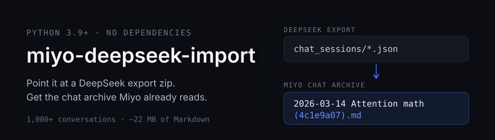

<p align="center">
  
</p>

DeepSeek's account export is a folder of JSON that nothing can open. This turns
it into one Markdown file per conversation, in the same shape Miyo writes for
ChatGPT and Claude: frontmatter, turn markers, timestamps, attachment links.

## What it produces

```
DeepSeek chats/
├── 2026-03-14 Attention math walkthrough (4c1e9a07).md
├── 2026-03-15 Measuring vector recall (d82b5f13).md
└── _attachments/
    └── 4c1e9a07/
        ├── packet-capture.png
        └── api-notes.pdf
```

```markdown
---
platform: deepseek
conversation_id: 4c1e9a07-...
title: "Attention math walkthrough"
url: https://chat.deepseek.com/a/chat/s/4c1e9a07-...
created_at: 2026-03-14T02:19:03.412000+00:00
updated_at: 2026-03-14T09:41:55.108000+00:00
---

# Attention math walkthrough

## Turn · 2026-03-14 02:19:03

**User · 2026-03-14 02:19:03**

...your message...

**Assistant · 2026-03-14 02:19:09**

...the reply...
```

The filename is `<date> <title> (<8 chars of id>).md`, so a conversation can be
found on disk without opening it. Timestamps are UTC, matching what Miyo writes
for the sources it already supports.

## Usage

Export from DeepSeek first: **Settings → Data → Export**, then download the
`deepseek_data-YYYY-MM-DD.zip`.

```bash
python3 deepseek_export_to_miyo.py deepseek_data-YYYY-MM-DD.zip "./DeepSeek chats"
```

A trial run first is worth it:

```bash
python3 deepseek_export_to_miyo.py deepseek_data-YYYY-MM-DD.zip "./DeepSeek chats" --limit 5
```

Python 3.9 or newer, standard library only. The source can also be an
already-extracted directory instead of the zip.

| Option | Effect |
|---|---|
| `--limit N` | convert only the first N conversations |
| `--no-attachments` | skip file copying entirely |
| `--quiet` | suppress per-file output |

## What gets converted

**The live branch only.** Regenerating an answer leaves the discarded replies in
the export as siblings sharing a `parent_id`. Walking back from
`current_message_id` keeps the answer you actually saw and drops the rest, which
is why a conversation shows up once rather than once per abandoned retry.

**Typed fragments, filtered.** DeepSeek splits a message into fragments with a
`type` field. `REQUEST`, `RESPONSE` and `TEMPLATE_RESPONSE` become body text.
`THINK` is dropped: reasoning traces aren't part of the conversation as
presented, and Miyo's other chat sources don't carry them either. Attachment
fragments (`FILE`) become links. Everything else, including tool calls and
search results, is skipped rather than dumped as raw JSON.

**Headings in body text are neutralized.** A line starting with `#` inside a
message would otherwise parse as document structure and break the turn layout,
so those lines get a zero-width space in front. Invisible when reading, inert
when parsing.

**Attachments are copied, not indexed.** Files land in
`_attachments/<8 chars of id>/` and are linked from the Markdown. They stay out
of the index on purpose: images and PDFs would slow the vector pass down for
very little retrieval value, and the native chat exports behave the same way.
Attachments the export references but doesn't include are marked
`_(name unavailable)_`.

## Where this stops

The output is plain Markdown in a folder, and Miyo indexes it as a **document
folder**. Its own chat sources carry an `origin` marker in the index manifest
that routes them into a separate `chats` collection: a folder without that
marker answers `--source files` rather than `--source chats`.

Registering a third chat platform has to happen on Miyo's side. The
`chat_platform` field only accepts `chatgpt` and `claude_ai` today, so an
imported source can't be labelled as a conversation source at all. That's what
[issue #68](https://github.com/Brevilabs/miyo-releases/issues/68) asks for, and
DeepSeek is already on its list.

This script deliberately doesn't touch Miyo's index database. A converter
shouldn't depend on private schema that moves between releases, and the fix
belongs upstream rather than in a workaround that breaks on the next update.

## Tested on

Miyo 0.4.3 on Windows, one export of 1,000+ conversations: 22 MB of Markdown
and about a hundred attachments across 38 MB.

## License

MIT. See [LICENSE](LICENSE).
